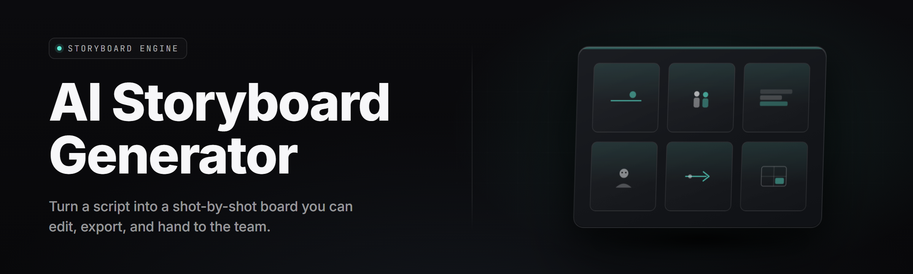

  
  
  

  

  
  

---

**Type a logline. Get a shot-by-shot storyboard with framing, camera moves, lighting notes, and dialogue — in under a minute.**

---

## 🎞️ Table of Contents

- [System Requirements](#-system-requirements)
- [The Problem](#-the-problem)
- [What Is an AI Storyboard Generator](#-what-is-an-ai-storyboard-generator)
- [Key Features](#-key-features)
- [Module Status](#-module-status)
- [Installation](#-installation)
- [Compatibility](#-compatibility)
- [Usage Guidelines](#-usage-guidelines)
- [Quick Start](#-quick-start)
- [Comparison](#-comparison)
- [Known Issues](#-known-issues)
- [FAQ](#-faq)
- [Changelog](#-changelog)

---

## 🖥️ System Requirements

| Component | Minimum | Recommended |
|---|---|---|
| OS | Windows 10 21H2 (x64) | Windows 11 23H2 (x64) |
| CPU | 4-core / 2.6 GHz | 8-core / 3.8 GHz (AVX2) |
| RAM | 8 GB | 16 GB |
| GPU | Not required (CPU rendering) | NVIDIA RTX 3060+ / 8 GB VRAM |
| VRAM | — | 6 GB for local diffusion previews |
| Storage | 4 GB free | 20 GB SSD (project cache + model bundles) |
| Runtime | .NET 8 Desktop Runtime | .NET 8 + DirectX 12 |
| Display | 1366×768 | 1920×1080 or higher |

The `.exe` bundles its own runtime dependencies. You do **not** need Python, Node, or a package manager.

---

## 🩸 The Problem

Storyboarding is the slowest part of pre-production and the fastest way to lose a producer's attention:

- **Hand-drawn boards take days.** A single 90-second commercial can eat a full week of an illustrator's time before anyone agrees on the ending.
- **Existing AI image tools don't understand film grammar.** They render *a* picture of a woman in a hallway — not an establishing wide, a push-in on the hands, and a reverse over the shoulder.
- **Continuity drifts between panels.** Same character, different jacket. Same room, different lamp. Same car, different plate. Editors notice.
- **Prompt-to-image tools give you one frame.** A storyboard is a *sequence* — numbered shots with camera, lens, movement, and duration attached.
- **Shot lists live in spreadsheets nobody reads.** The director wants a visual; the DP wants an FOV; the editor wants timecodes. One file should carry all three.
- **Iteration is expensive.** "Move the reveal one beat earlier" shouldn't mean re-hiring an artist.
- **Exports are locked to one tool.** Boards leave as flat PNGs and never make it back into a shot list, a call sheet, or a timeline.

---

## 📖 What Is an AI Storyboard Generator

| Term | Explanation |
|---|---|
| **Logline** | One-to-two sentence summary of the scene; the generator's primary input. |
| **Shot** | A single framed unit — wide, medium, close-up, insert — with duration and camera metadata. |
| **Beat** | A story event; the generator splits a logline into narrative beats before rendering shots. |
| **Panel** | The rendered image for one shot, annotated with framing and lens info. |
| **Shot list** | Structured table of number, description, camera move, lens, duration, and dialogue. |
| **Continuity sheet** | Character/wardrobe/prop/lighting reference locked across a sequence. |
| **Animatic** | Timed slideshow of panels using shot durations; exportable as MP4 or WebM. |
| **Coverage preset** | Rule set defining how a scene is broken into shots (dialogue-heavy, action, montage). |

**Why people use it over a pile of disconnected tools:**

- A logline becomes a numbered shot list *and* a visual board in one pass.
- Camera moves, focal lengths, and durations are attached per shot, not guessed later.
- Character sheets lock wardrobe and props across an entire sequence.
- Every project exports as PNG, PDF, CSV, or animatic MP4 — no vendor lock.
- Boards re-render in place when you edit a beat; numbering and metadata stay intact.
- Presets ship for commercials, music videos, short films, and series pitch decks.

---

## 🎯 Key Features

| Feature | Description | Benefit |
|---|---|---|
| Logline-to-Board | Splits a logline into beats, then shots, then panels | First pass in under 60 seconds |
| Coverage Presets | Dialogue, action, montage, chase, pitch, and custom rule sets | Boards that read like a real script supervisor wrote them |
| Camera Engine | Framing, lens, movement, and angle attached per shot | DP gets FOV, not vibes |
| Continuity Locker | Character, wardrobe, prop, and lighting refs stay consistent | No dropped jackets between panels |
| Animatic Builder | Renders timed slideshow from shot durations | Pre-vis for editors and clients |
| Shot List Export | CSV, XLSX, and PDF tables | Drops straight into a call sheet |
| Panel Annotator | Overlays shot number, lens, movement callouts | Board reads standalone |
| Style Presets | Noir, storybook ink, photoreal, anime, previz grey | Match the pitch deck in one click |
| Local Diffusion Mode | Runs local SD/Flux checkpoints offline | No API key, no rate limit, no upload |
| Cloud Fallback | Optional hosted renderer for machines without a GPU | Never stuck on a weak laptop |
| Beat Editor | Reorder, split, or merge beats and re-render affected shots | Cheap iteration |
| Multi-Sequence Projects | Group sequences into acts with running numbering | Feature-length work supported |

---

## 🧩 Module Status

| Module | Status | Description |
|---|---|---|
| `beat_parser` | ✅ Working | Logline → narrative beats |
| `shot_splitter` | ✅ Working | Beats → numbered shots |
| `camera_engine` | ✅ Working | Lens, framing, move, angle |
| `continuity_locker` | ✅ Working | Character/prop consistency |
| `panel_renderer` | ✅ Working | Image generation per shot |
| `panel_annotator` | ✅ Working | Overlay shot metadata |
| `style_presets` | ✅ Working | 14 built-in visual styles |
| `coverage_presets` | ✅ Working | 9 coverage rule sets |
| `shotlist_exporter` | ✅ Working | CSV / XLSX / PDF |
| `animatic_builder` | ✅ Working | Timed slideshow → MP4/WebM |
| `pdf_board_layout` | ✅ Working | Print-ready board PDFs |
| `character_sheet` | ✅ Working | Reference art per character |
| `prop_registry` | ✅ Working | Track key props across shots |
| `lighting_notes` | ✅ Working | Per-shot light direction and mood |
| `sound_cue_tagger` | ✅ Working | Attach SFX/music cue notes |
| `duration_estimator` | ✅ Working | Auto-duration from beat pace |
| `dialogue_aligner` | ✅ Working | Assign VO/sync lines per shot |
| `revision_tracker` | ✅ Working | Diff boards between drafts |
| `batch_queue` | ✅ Working | Queue many loglines overnight |
| `project_archive` | ✅ Working | Portable .sbproj bundles |
| `local_diffusion` | 🟡 Beta | Offline SD/Flux rendering |
| `cloud_render` | ✅ Working | Hosted fallback renderer |
| `timeline_export` | 🟡 Beta | Premiere / Resolve XML |
| `subtitle_burn` | ✅ Working | Burn VO lines into animatic |
| `multi_sequence` | ✅ Working | Acts with running numbering |
| `theme_market` | 🟡 Beta | Community style packs |
| `api_bridge` | ✅ Working | Local REST endpoint for pipelines |
| `plate_swap` | 🔵 Planned | Live-action plate integration |
| `stereo_board` | 🔵 Planned | Side-by-side stereo coverage |
| `vr_previz` | 🔵 Planned | 360° previz preview |

---

  

> **Heads up:** the `.exe` is signed. SmartScreen may still ask once on first launch — click **More info → Run anyway**. Admin rights are only needed if you install to `Program Files`.

---

## 💾 Installation

1. **Download the installer package** using the download button above. You'll get a single `.exe`.
2. **Extract (if zipped).** Right-click the archive → *Extract All*. Do not run from inside the archive.
3. **Run the `.exe`.** Windows will register the app, create a `%APPDATA%\AIStoryboardGenerator` folder for projects, and drop a Start Menu shortcut.
4. **First launch.** The setup wizard offers **Local (CPU)** or **Local (GPU)** rendering. Pick CPU if you don't have an NVIDIA card — you can switch later.
5. **Optional: local model bundle.** If you want offline diffusion, click *Fetch Model Bundle* in Settings. It's ~6 GB and skips cloud rendering entirely.

No `pip install`, no `npm i`, no `git clone`. Everything ships inside the `.exe`.

---

## 🔌 Compatibility

| Platform | Support | Notes |
|---|---|---|
| Windows 11 (23H2+) | ✅ Full | Recommended target |
| Windows 10 (21H2+) | ✅ Full | CPU rendering advised without GPU |
| Windows Server 2022 | ⚠️ Partial | No Store; manual shortcut only |
| macOS | 🔵 Roadmap | M-series native build planned |
| Linux (Ubuntu 22.04) | 🔵 Roadmap | AppImage planned |
| Wine / Proton | ⚠️ Experimental | GPU path untested |

---

## 📜 Usage Guidelines

| Allowed | Not allowed |
|---|---|
| Storyboarding your own scripts, pitches, and spec work | Reselling raw generated panels as stock art |
| Using boards for client presentations and pre-vis | Stripping metadata and reposting as your own illustration portfolio |
| Training your own style packs from your own art | Feeding scraped artist work without license |
| Integrating the REST bridge into your pipeline | Using the API bridge to run a public render farm |
| Shipping animatics to editors and sound teams | Bypassing the license gate to redistribute the `.exe` |

---

## 🫡 Quick Start

1. 🎬 **Launch the `.exe`** and click **New Project**.
2. ✍️ **Paste your logline.** Example: *"A courier realizes the briefcase she's carrying belongs to a hitman."*
3. 🎚️ **Pick a coverage preset** — *Dialogue* for the above, or *Action* for chases.
4. 🎨 **Pick a style preset.** *Previz Grey* is fastest; *Noir Ink* looks best in a pitch.
5. ⏱️ **Hit Generate.** Beats appear first, then shots, then panels. When it's done, export as PDF + CSV, or build an animatic.
6. 🔁 **Edit a beat**, re-render only the affected shots, and hit **Revision Snapshot** before the next pass.

---

## ⚖️ Comparison

| Aspect | Manual Boards | Generic Image AI | This Tool |
|---|---|---|---|
| Speed to first pass | Days to weeks | Minutes per image | Under 60 seconds per sequence |
| Understands film grammar | Yes (artist-dependent) | No | Yes (camera + coverage engine) |
| Continuity across panels | Manual effort | Unreliable | Locked by continuity sheet |
| Shot metadata (lens/move) | Separate doc | Absent | Attached per panel |
| Export formats | PSD / PDF | PNG / JPG | PNG, PDF, CSV, XLSX, MP4, WebM |
| Iteration cost | Re-draw | Re-prompt | Re-render affected shots only |
| Offline capable | Yes | Rarely | Yes (local diffusion mode) |
| Cost model | Per-artist day rate | Per-image credits | One-time license |

---

## 🐞 Known Issues

| Issue | Fix |
|---|---|
| First launch stalls on "Loading tokens" | Delete `%APPDATA%\AIStoryboardGenerator\cache\tokens.bin`, relaunch |
| Panels render at wrong aspect ratio | Set project aspect in *Project → Format* before generating |
| Local GPU mode falls back to CPU silently | Check *Settings → Renderer*. Driver < 552.xx blocks GPU path |
| PDF board export cuts off last panel | Switch to *Fit to Page* in export dialog, or export via XLSX → Excel |
| Animatic MP4 has no audio track | Enable *Burn VO Lines* in the animatic dialog before export |
| Continuity sheet loses prop after beat merge | Re-link prop in *Props* tab; merge doesn't propagate automatically |

---

## ❓ FAQ

<strong>Do I need a GPU to use this?</strong>

No. CPU rendering works out of the box. It's slower — roughly 8–12 seconds per panel on a modern 6-core — but it's fully functional.

<strong>Is this running a cloud model?</strong>

Only if you choose it. The default is local rendering on your machine. Cloud is a fallback you enable in Settings.

<strong>Can I import my own character references?</strong>

Yes. Drop images into the Continuity Locker and tag them by character or prop name. They'll be used as conditioning refs for every shot that names them.

<strong>Does it work on multiple monitors?</strong>

Yes. The board view, shot list, and reference panels are dockable windows.

<strong>What happens to my projects if I reinstall?</strong>

Projects live in `%APPDATA%\AIStoryboardGenerator\projects` and survive reinstall. Export a `.sbproj` bundle as a portable backup.

**Q:** Can I use this for a full feature film?
**A:** Yes — multi-sequence projects support acts with running shot numbering. Boards get large but stay organized.

**Q:** Does it output to Premiere or Resolve?
**A:** Timeline XML export is in beta. You get markers, durations, and panel thumbnails per shot.

**Q:** Are style packs shareable?
**A:** Yes. A style pack is a small `.sbsty` file you can zip and share. The theme market is in beta.

**Q:** How are revisions tracked?
**A:** Every save creates a snapshot. Open *Revisions* to diff boards side by side.

---

## 🗓️ Changelog

- **v2.4.1** — Faster beat parser, fixed GPU fallback detection.
- **v2.4.0** — Animatic audio burn, subtitle track, revisions diff view.
- **v2.3.6** — New coverage presets (chase, montage), style pack loader.

---

## 🍀 Closing

Every project you build here is yours — boards, shot lists, animatics, all of it. The `.exe` doesn't phone home, doesn't watermark your panels, and doesn't lock exports behind a subscription. Open it, drop a logline, and watch a scene fall into shots before your coffee gets cold.

  

